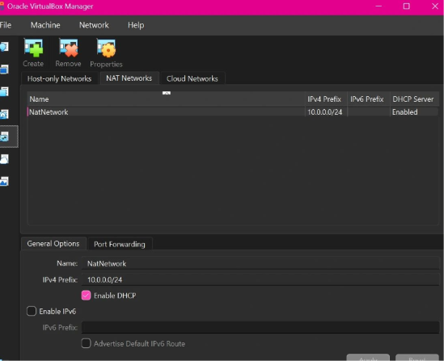
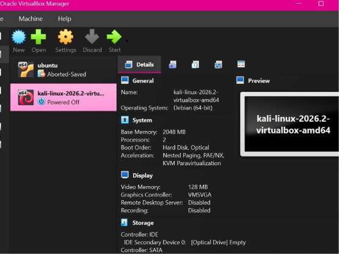
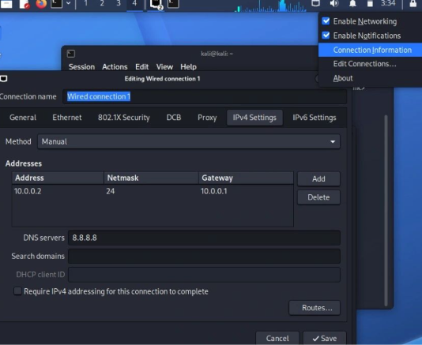
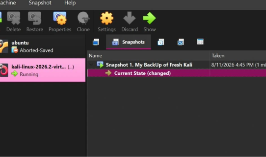

# Week 01 | Practical Cybersecurity Lab Environment Setup

## Overview

As part of my Cybersecurity Internship at **NETWORKWALKS**, this module focuses on establishing a virtualized lab environment for hands-on cybersecurity and ethical hacking practice.

The objective is to configure a controlled testing environment using Oracle VirtualBox and Kali Linux while strengthening practical knowledge of virtualization, network configuration, and virtual machine management.

## Tools and Technologies

- Oracle VirtualBox
- Kali Linux 2026.2
- Windows 11 (Host Operating System)
- NAT Networking
- Linux Networking Utilities

## Lab Objectives

- Set up a Kali Linux virtual machine using Oracle VirtualBox.
- Configure a custom NAT Network.
- Assign a static IPv4 address and configure network parameters.
- Configure gateway and DNS settings.
- Enable virtual machine integration features.
- Verify network connectivity and Internet access.
- Create a VM snapshot for backup and recovery.

## Implementation

### 1. NAT Network Configuration

Configured a custom NAT Network in Oracle VirtualBox with DHCP enabled to provide a virtual networking environment.



### 2. Kali Linux Virtual Machine

Set up Kali Linux in Oracle VirtualBox as the primary environment for cybersecurity testing and practical exercises.



### 3. Network Configuration

Configured manual IPv4 addressing, the default gateway, and DNS settings through Kali Linux Network Manager.



### 4. Virtual Machine Snapshot

Created a VM snapshot to preserve the configured environment and support recovery if future experiments affect the system.



## Verification

The following commands can be used to verify the lab's network configuration and connectivity.

```bash
ip -4 addr show eth0
ip route
ping -c 4 8.8.8.8
ping -c 4 google.com
```

### 5. Kali Linux Terminal Verification

Network configuration and connectivity testing using Kali Linux terminal.


These checks help validate interface addressing, routing, external network connectivity, and DNS resolution.

**Verification status:** Final connectivity and VM integration checks are pending confirmation.

## Key Learning Outcomes

- Practical understanding of virtualization.
- Configuring and managing NAT Networks.
- Static IPv4 addressing and network management.
- Virtual machine snapshot and recovery procedures.
- Importance of isolated lab environments for cybersecurity practice.

## Conclusion

This module provided an opportunity to reinforce fundamental virtualization and networking concepts through practical configuration.

The lab serves as a foundation for upcoming cybersecurity exercises, ethical hacking practice, and security testing activities.

---

**Program:** NETWORKWALKS Cybersecurity Internship  
**Module:** Week 01 – Project Module 1  
**Focus:** Practical Lab Environment Setup
